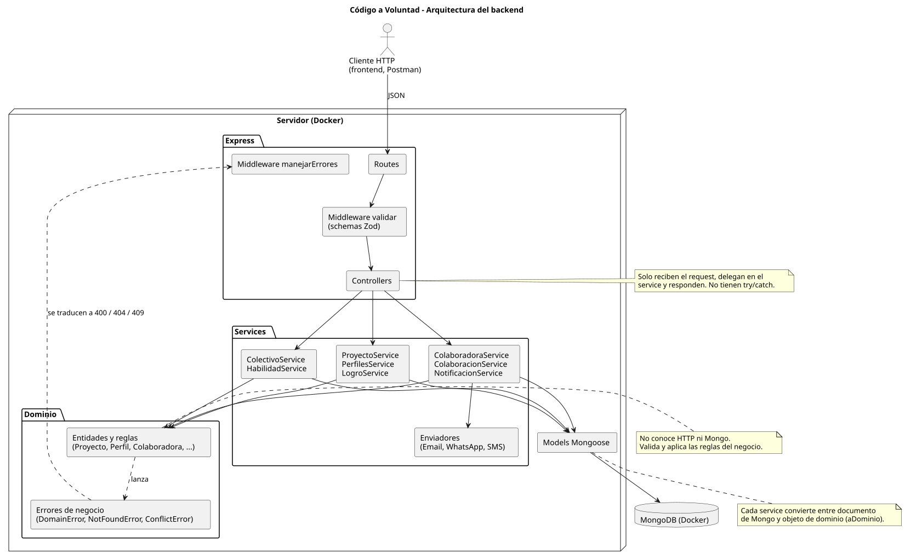
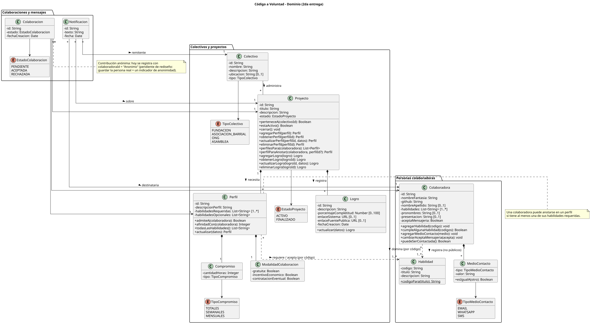
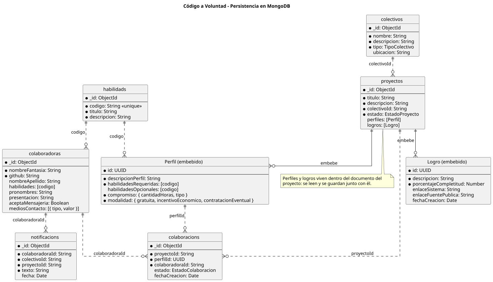

# Código a Voluntad

Trabajo Práctico Integrador de Desarrollo de Software, UTN FRBA, segundo cuatrimestre de 2026. Grupo 3.

Estado: tercera entrega (interfaz web, login, postulaciones y adicionales). La aplicación está publicada en https://codigo-a-voluntad-g3.onrender.com (front y API en la misma URL).

## Integrantes

- Camila Sol Hernández Greco
- Santiago Martín
- Luca Belardinelli
- Francisco Nicolas Bosi
- Pedro Jose Nicolas Alvarez

## Contenido

- [Qué es](#qué-es)
- [Cómo levantarlo](#cómo-levantarlo)
- [Arquitectura](#arquitectura)
- [Dominio](#dominio)
- [Persistencia](#persistencia)
- [API](#api)
- [Datos semilla y cuentas de prueba](#datos-semilla-y-cuentas-de-prueba)
- [Tests](#tests)
- [Entregables de la 3ra entrega](#entregables-de-la-3ra-entrega)
- [Decisiones de diseño](#decisiones-de-diseño)
- [Pendientes](#pendientes)
- [Plan de entregas](#plan-de-entregas)
- [Git Flow](#git-flow)

## Qué es

Código a Voluntad conecta colectivos (fundaciones, asociaciones barriales, ONGs, asambleas) que necesitan software y no pueden pagarlo con personas colaboradoras que quieren aportar trabajo y asesoramiento.

Un colectivo publica proyectos y, en cada uno, los perfiles que busca (por ejemplo "Tester, 5 horas mensuales, sin incentivo económico"). Una colaboradora se postula a un perfil, el colectivo acepta o rechaza, y recién cuando acepta puede ver sus datos de contacto. El proyecto registra su avance con logros y tareas.

### Stack

| Parte | Tecnología |
|---|---|
| Backend | Node.js 20, Express 5, Zod para validar los pedidos |
| Base de datos | MongoDB 7 con Mongoose |
| Frontend | React 19 (Create React App) y Axios |
| Autenticación | Cookie de sesión HttpOnly, contraseñas con scrypt |
| Tests | Jest, `mongodb-memory-server` y Testing Library |
| Documentación de la API | Swagger (OpenAPI 3) y colección de Postman |
| Despliegue | Docker. En producción, Render (app) y MongoDB Atlas (base) |

### Estructura del repositorio

```
├── docker-compose.yml        backend + MongoDB
├── DEPLOY.md                 cómo desplegar (local, Render, servidor propio)
├── REQUERIMIENTOS_NO_FUNCIONALES.md   justificación de los lineamientos de UI
└── packages/
    ├── backend/
    │   ├── index.js          arranque del servidor y del job de cierre automático
    │   ├── docs/openapi.json especificación exportada
    │   ├── postman_collection.json
    │   ├── src/
    │   │   ├── app.js        armado de Express y orden de los middlewares
    │   │   ├── routes/       rutas HTTP
    │   │   ├── controllers/  leen el pedido, llaman al service y responden
    │   │   ├── services/     casos de uso: leen y guardan en Mongo y usan el dominio
    │   │   ├── domain/       entidades y reglas de negocio, sin HTTP ni Mongo
    │   │   ├── models/       schemas de Mongoose
    │   │   ├── schemas/      validación de los pedidos con Zod
    │   │   ├── middlewares/  sesión, autorización, límites de tasa, errores
    │   │   ├── jobs/         cierre automático de proyectos vencidos
    │   │   ├── seeds/        datos de ejemplo
    │   │   └── docs/         definición de Swagger
    │   └── test/             dominio, services, API HTTP, jobs y utilidades
    ├── frontend/
    │   ├── src/              App.js y un componente por funcionalidad
    │   ├── ENTREGA3.md       guía de la 3ra entrega: recorridos y adicionales
    │   └── ADICIONALES.md    términos, límite de tasa, Markdown, huella IA y RSS
    └── diagrama-de-clases/   diagramas PlantUML (.puml) y su render (.svg)
```

## Cómo levantarlo

Hace falta Node.js 20 o más nuevo.

### Para desarrollar

```bash
npm install                                     # desde la raíz (npm workspaces)
docker compose up -d mongo                      # MongoDB en localhost:27017
cp packages/backend/.env.example packages/backend/.env
npm run seed --workspace=backend                # opcional: datos de ejemplo (borra la base)
npm run dev                                     # backend en :8000 y front en :3000
```

Abrir http://localhost:3000. Swagger queda en http://localhost:8000/api-docs. Conviene usar siempre `localhost` y no mezclarlo con `127.0.0.1`, porque la cookie de sesión depende del origen.

### Todo con Docker

```bash
docker compose up --build                       # app completa en http://localhost:3000
docker compose exec backend npm run seed        # datos de ejemplo
```

La imagen compila el front y el backend lo sirve junto con la API, igual que en producción.

### Variables de entorno (`packages/backend/.env`)

Están todas en [`.env.example`](packages/backend/.env.example) con su explicación. Las principales:

| Variable | Para qué |
|---|---|
| `MONGO_URI` | Conexión a MongoDB |
| `SERVER_PORT` / `PORT` | Puerto del backend (`PORT` tiene prioridad; por defecto 8000) |
| `ALLOWED_ORIGINS` | Orígenes que pueden llamar a la API (CORS y chequeo de `Origin` en escrituras) |
| `NODE_ENV` | En `production` la cookie es `Secure` y se confía en el proxy |
| `PUBLIC_APP_URL` | URL pública del front, para los enlaces de RSS y LinkedIn |
| `ADMIN_API_KEY` | Clave de administración (habilidades, términos, denuncias). Mínimo 32 caracteres |
| `PUBLIC_RATE_LIMIT` / `PUBLIC_RATE_WINDOW_MS` | Límite de pedidos por IP (120 por minuto por defecto) |
| `EXPORT_RATE_LIMIT` / `EXPORT_RATE_WINDOW_MS` | Límite de descargas de "Mis datos" por cuenta |
| `TELEGRAM_BOT_TOKEN` | Envío real por Telegram. Sin el token se simula por consola |
| `SENDGRID_API_KEY` / `EMAIL_FROM` | Envío real de emails con la API de SendGrid. Sin la clave se simula por consola |
| `LINKEDIN_*` | Integración con LinkedIn. Sin estas variables esa función responde 503 y el resto anda igual |

Las claves reales van solo en el `.env` local o en el panel de Render, nunca en el repo.

### Scripts

| Comando (desde la raíz) | Qué hace |
|---|---|
| `npm run dev` | Backend y front juntos, con recarga |
| `npm run dev:backend` / `npm run start:frontend` | Cada uno por separado |
| `npm test --workspace=backend` | Tests del backend |
| `npm test --workspace=frontend -- --watchAll=false` | Tests del front |
| `npm run build --workspace=frontend` | Build de producción del front |
| `npm run seed --workspace=backend` | Borra las colecciones principales y carga los datos de ejemplo |
| `npm run openapi --workspace=backend` | Regenera `docs/openapi.json` desde la definición de Swagger |
| `npm run lint` | ESLint de todo el repo |

## Arquitectura

Cliente pesado en React que habla con una API JSON en Express. En producción hay un solo servicio: el backend sirve el front compilado y la API bajo la misma URL, y la base está en MongoDB Atlas. El detalle está en [DEPLOY.md](DEPLOY.md).



El backend está en capas y cada una solo conoce a la de abajo:

| Capa | Qué hace | Qué no hace |
|---|---|---|
| Routes | Definen la ruta y la cadena de middlewares (validación con Zod, sesión) | Lógica |
| Controllers | Leen parámetros, cuerpo y sesión, llaman al service y responden | Reglas de negocio ni acceso a Mongo |
| Services | Casos de uso: buscan en Mongo, arman el objeto de dominio, le piden la operación y guardan | Reglas propias de cada entidad |
| Dominio | Entidades con sus reglas (por ejemplo `Proyecto.validarSePuedeAnotar` o `Tarea.actualizar`) | Saber de HTTP o de Mongo |
| Models | Schemas de Mongoose | Validaciones de negocio |

Antes de llegar a las rutas, cada pedido a `/api` pasa por: límite de tasa por IP, `resolverSesion` (lee la cookie y deja la cuenta en `req.cuenta`), las rutas de autenticación y de "Mis datos", y `autorizar`, que decide quién puede modificar qué (por ejemplo, solo el colectivo dueño edita su proyecto).

### Errores

El dominio y los services lanzan errores de negocio (`src/domain/errores.js`) y el middleware `manejarErrores` los pasa a HTTP. Como Express 5 propaga los errores de las funciones `async`, los controllers no necesitan `try/catch`.

| Error | Status | Ejemplo |
|---|---|---|
| `DomainError` | 400 | Datos inválidos, o la colaboradora no tiene ninguna habilidad requerida |
| sin sesión | 401 | Lo responden `autorizar` y `requiereSesion` |
| `ForbiddenError` o `autorizar` | 403 | Un colectivo intenta editar un proyecto ajeno |
| `NotFoundError` | 404 | El recurso no existe o el id tiene mal formato |
| `ConflictError` | 409 | Ya se postuló a ese perfil, o el proyecto ya está finalizado |
| límite de tasa | 429 | Demasiados pedidos |
| `UnavailableError` | 503 | Falta configurar un servicio externo (LinkedIn, clave de administración) |

Todas las respuestas de error tienen la forma `{ "error": "mensaje", "detalle": { ... } }`.

## Dominio



Fuente editable: [Diagrama.puml](packages/diagrama-de-clases/Diagrama.puml).

Reglas principales:

- Perfiles. Cada proyecto publica perfiles con descripción, al menos una habilidad requerida, habilidades opcionales, compromiso (horas totales, semanales o mensuales) y modalidad (gratuita, con incentivo económico, con posible contratación). Opcionalmente, un cupo de colaboraciones y una fecha límite para postularse.
- Búsqueda abierta. El colectivo puede pausar y reabrir la búsqueda del proyecto. Solo se aceptan postulaciones con el proyecto activo, la búsqueda abierta y el perfil dentro de su fecha.
- Postulaciones. La colaboradora se postula a un perfil si tiene al menos una habilidad requerida. Queda pendiente hasta que el colectivo la acepta o la rechaza. Al aceptar se crea la colaboración, y no se puede aceptar por encima del cupo.
- Contactos. Los medios de contacto de una colaboradora no salen en ninguna respuesta pública. Solo los ven ella y los colectivos con los que tiene una colaboración aceptada; para cualquier otra persona el pedido falla con 403.
- Bajas. El colectivo puede dar de baja a una colaboradora y ella puede darse de baja sola. Es permanente: la colaboración queda en el historial como terminada y la interfaz lo advierte antes.
- Anonimato. Una colaboradora puede postularse de forma anónima: el público no ve quién es, pero el colectivo dueño sí.
- Cierre. El colectivo puede finalizar un proyecto en cualquier momento, o fijar una fecha de cierre y que se cierre solo. Al finalizar se rechazan las postulaciones pendientes y se cierran las tareas sin terminar.
- Habilidades. Se identifican por un código que es el título normalizado (`"Diseño UX"` → `"diseño-ux"`). Las carga la administración.
- Notificaciones. Un colectivo puede escribirle a una colaboradora compatible con un perfil si ella acepta mensajes. El mensaje queda en su bandeja y se replica por sus medios de contacto (el email se manda de verdad si hay SMTP; SMS y WhatsApp se simulan).
- Logros y tareas. El avance del proyecto se registra con logros (porcentaje y enlaces al sistema y al código) y con tareas que se ven en un diagrama de Gantt.

## Persistencia

Todo se guarda en MongoDB. Perfiles y logros van embebidos en el documento del proyecto, porque siempre se leen y se modifican junto con él. Las tareas tienen su propia colección para no inflar el proyecto. Cuentas y sesiones están separadas de los perfiles públicos, así el email de acceso y el hash de la contraseña nunca viajan con un colectivo o una colaboradora.



## API

La documentación completa de cada endpoint (cuerpos, respuestas y errores) está en Swagger:

- Producción: https://codigo-a-voluntad-g3.onrender.com/api-docs
- Local: http://localhost:8000/api-docs
- Especificación versionada: [`packages/backend/docs/openapi.json`](packages/backend/docs/openapi.json)

Desde Swagger se puede probar todo: primero `POST /api/auth/registro` o `/api/auth/login`, y el navegador guarda la cookie y la manda en los pedidos siguientes.

La [colección de Postman](packages/backend/postman_collection.json) recorre los casos de uso de la entrega de punta a punta. Cómo correrla está más abajo, en [Colección de Postman](#colección-de-postman).

### Endpoints por área

| Área | Rutas principales |
|---|---|
| Salud | `GET /health` |
| Autenticación | `POST /api/auth/registro`, `POST /api/auth/login`, `GET /api/auth/sesion`, `POST /api/auth/logout` |
| Habilidades | `GET /api/habilidades`, `POST /api/habilidades` (administración) |
| Colectivos | `GET /api/colectivos`, `PATCH /api/colectivos/:id`, `DELETE /api/colectivos/:id/cuenta` |
| Colaboradoras | `GET /api/colaboradoras`, `GET` y `PATCH /api/colaboradoras/:id`, habilidades, experiencia, medios de contacto, preferencias, `DELETE /api/colaboradoras/:id/cuenta` |
| Proyectos | `GET /api/proyectos`, `GET /api/proyectos/:id`, y bajo `/api/colectivos/:colectivoId/proyectos`: crear, editar, finalizar, eliminar y abrir o cerrar la búsqueda |
| Perfiles | CRUD en `/api/proyectos/:proyectoId/perfiles` |
| Búsquedas | `GET /api/proyectos/:id/perfiles/:perfilId/colaboradoras-potenciales`, `GET /api/colaboradoras/:id/proyectos-potenciales`, filtro `?etiquetas=` en proyectos y colectivos |
| Postulaciones | `POST /api/proyectos/:id/postularse`, pendientes y procesadas en `/api/colectivos/:colectivoId/proyectos/:proyectoId/postulaciones`, aceptar o rechazar con `PATCH .../postulaciones/:postulacionId`, `GET /api/mi/postulaciones` |
| Colaboraciones y bajas | `GET /api/colaboraciones`, `DELETE /api/colectivos/colaboraciones/:id` (baja por el colectivo), `DELETE /api/colaboradoras/:id/proyectos/:proyectoId/baja` (baja por la colaboradora) |
| Contactos | `GET /api/colaboradoras/:id/contactos` |
| Mensajes | `POST /api/notificaciones`, `GET /api/colaboradoras/:id/notificaciones` |
| Logros | CRUD en `/api/proyectos/:proyectoId/logros` |
| Tareas (Gantt) | CRUD en `/api/proyectos/:proyectoId/tareas` |
| Mis datos | `GET /api/mi/exportacion?formato=json\|csv` |
| Términos | `GET /api/terminos/actual` y administración en `/api/admin/terminos` |
| Denuncias | `POST /api/denuncias` y administración en `/api/admin/denuncias` |
| LinkedIn | `/api/integraciones/linkedin` (estado, conectar, importar perfil, publicar logro) |
| RSS | `GET /api/rss/proyectos.xml`, `GET /api/rss/colectivos.xml` |

`POST /api/colectivos` y `POST /api/colaboradoras` quedaron de la 2da entrega y están marcados como obsoletos: el alta ahora se hace con `/api/auth/registro`, que crea la cuenta y el perfil juntos.

### Ejemplo: postularse y aceptar

La colaboradora, con su sesión, se postula a un perfil:

```http
POST /api/proyectos/650000000000000000000201/postularse
Content-Type: application/json
Cookie: cav_session=...

{ "colaboradoraId": "<su id>", "perfilId": "<id del perfil>", "anonimidad": false }
```

Responde 200 con la postulación en estado `PENDIENTE`. El colectivo dueño, con su sesión, la acepta:

```http
PATCH /api/colectivos/650000000000000000000101/proyectos/650000000000000000000201/postulaciones/<id>
Content-Type: application/json
Cookie: cav_session=...

{ "estado": "ACEPTADA" }
```

A partir de ahí el colectivo puede consultar `GET /api/colaboradoras/<id>/contactos`.

## Datos semilla y cuentas de prueba

`npm run seed --workspace=backend` borra habilidades, colectivos, colaboradoras, proyectos, colaboraciones, notificaciones y tareas, y carga 9 habilidades, 3 colectivos, 5 colaboradoras, 4 proyectos (uno finalizado) con perfiles, logros, etiquetas, colaboraciones, una notificación y 12 tareas para el Gantt. Los datos pasan por las mismas validaciones del dominio que la API.

Los perfiles del seed no tienen cuenta ni contraseña, así que sirven para mirar pero no para iniciar sesión. Para probar los recorridos hay que crear cuentas desde "Iniciar sesión / Registrarme → Crear cuenta". Una colaboradora con la habilidad `react` puede postularse enseguida a "Web de donaciones" o a "Plataforma de cursos".

El seed no toca cuentas, sesiones, postulaciones ni denuncias. No conviene correrlo sobre una base con cuentas reales, porque quedarían apuntando a perfiles borrados.

Ids fijos (detalle en [`src/seeds/datos.js`](packages/backend/src/seeds/datos.js)):

| Entidad | Id |
|---|---|
| Colectivo "Fundación Manos Unidas" | `650000000000000000000101` |
| Colectivo "Asamblea Villa Crespo" | `650000000000000000000102` |
| Colectivo "ONG Código Abierto" | `650000000000000000000103` |
| Proyecto "Web de donaciones" | `650000000000000000000201` |
| Proyecto "API de inventario" | `650000000000000000000202` |
| Proyecto "Plataforma de cursos" | `650000000000000000000203` |
| Proyecto "Encuesta vecinal" (finalizado) | `650000000000000000000204` |
| Colaboradora "Ada" (react, javascript; acepta mensajes) | `650000000000000000000301` |
| Colaboradora "Grace" (nodejs, bases-de-datos) | `650000000000000000000302` |
| Colaboradora "Lu" (diseño-ux; no acepta mensajes) | `650000000000000000000303` |
| Colaboradora "Pyto" (python, pandas) | `650000000000000000000304` |
| Colaboradora "Sol" (fullstack y testing) | `650000000000000000000305` |

Los ids de perfiles y logros se generan al cargar; se obtienen con `GET /api/proyectos/:id`.

## Tests

```bash
npm test --workspace=backend
npm test --workspace=frontend -- --watchAll=false
```

Backend (`packages/backend/test`), contra un MongoDB real en memoria:

- `domain/`: reglas de cada entidad, sin base de datos.
- `services/*Service.test.js`: casos de uso contra Mongo.
- `services/*Http.test.js`: tests de integración de la capa de controladores. Levantan la app real con `crearApp()` y le hacen pedidos HTTP con sesiones de verdad. Por ejemplo, `AuthHttp.test.js` cubre registro, login, permisos entre colectivos, contactos antes y después de aceptar, y aceptaciones simultáneas con cupo.
- `jobs/` y `utils/`: cierre automático, sanitización y CSV.

Frontend (`packages/frontend/src/*.test.js`), con Testing Library y la API simulada. El test de integración es `App.test.js` ("permite explorar y postularse desde una sesión de colaboradora"): renderiza la app completa con una sesión de colaboradora, abre un proyecto, se postula y comprueba el pedido enviado y el mensaje de confirmación. Hay otros parecidos para tareas y etiquetas.

### Colección de Postman

La colección recorre todos los casos de uso de punta a punta en 19 carpetas: habilidades, registro y sesiones, colectivos, colaboradoras, proyectos, perfiles, búsquedas, postulaciones, contactos, mensajes, logros, tareas, bajas, etiquetas, finalizar, portabilidad, RSS y eliminación de cuentas. Son 166 pedidos con 289 verificaciones, entre casos que tienen que andar y casos que tienen que fallar (401, 403, 409...).

No depende del seed: cada corrida crea sus propias habilidades, cuentas y proyectos con un sufijo al azar, así que se puede correr varias veces sobre la misma base.

```bash
npx newman run packages/backend/postman_collection.json \
  --env-var baseUrl=http://localhost:8000 \
  --env-var adminApiKey=<la ADMIN_API_KEY del backend>
```

En la app de Postman: importar el archivo, completar las variables `baseUrl` y `adminApiKey` de la colección y correrla entera, en orden, con el Collection Runner.

Cada pedido manda la cookie de sesión a mano (`Cookie: cav_session={{...}}`) y tiene desactivado el almacén de cookies, porque la colección maneja varias cuentas a la vez y si no las sesiones se mezclarían.

Hay que tener en cuenta dos límites del backend:

- Una corrida hace 166 pedidos en unos 20 segundos, así que con el límite por defecto (120 por minuto) recibe 429. Para correrla, levantar el backend con `PUBLIC_RATE_LIMIT=1000` o agregar una demora en el Runner.
- Registro y login permiten 20 intentos cada 15 minutos por IP, y cada corrida usa 9. Después de dos corridas seguidas hay que esperar 15 minutos o reiniciar el backend.

## Entregables de la 3ra entrega

| Entregable | Dónde está |
|---|---|
| Pantallas y navegación | La app publicada. Recorridos paso a paso en [ENTREGA3.md](packages/frontend/ENTREGA3.md) |
| Justificación de los requerimientos no funcionales | [REQUERIMIENTOS_NO_FUNCIONALES.md](REQUERIMIENTOS_NO_FUNCIONALES.md) |
| Aplicación desplegada | https://codigo-a-voluntad-g3.onrender.com, detalle en [DEPLOY.md](DEPLOY.md) |
| Test de integración en controladores | `packages/backend/test/services/*Http.test.js` |
| Test de integración en el front | `packages/frontend/src/App.test.js` |

Adicionales implementados: LinkedIn (importar perfil y publicar logros, 1 y 2), RSS (5), cierre automático (10), sanitización (11), límite de tasa (14), modo daltónico (20), términos y condiciones (21), denuncias (22), eliminación de colectivos (23) y de cuentas personales (24), portabilidad de datos (26), diagrama de Gantt (33), etiquetas (34), huella IA (36), experiencia por habilidad (37) y Markdown (38). Cómo probar cada uno está en [ENTREGA3.md](packages/frontend/ENTREGA3.md) y [ADICIONALES.md](packages/frontend/ADICIONALES.md).

## Decisiones de diseño

- Las habilidades se referencian por código, no por título ni por id de Mongo. El código es único y legible, y es lo que el enunciado define como identificador.
- Alcanza con una habilidad requerida para postularse, como dice el enunciado ("al menos una de las habilidades requeridas"). Las opcionales solo sirven para ordenar las búsquedas.
- La postulación y la colaboración son entidades distintas. La postulación es el pedido y su decisión; la colaboración existe solo si se aceptó, y guarda la fecha de alta y la de baja para armar el historial.
- Las bajas son lógicas. Una colaboración dada de baja queda como terminada y no se puede reactivar; así el historial de la colaboradora y del proyecto no pierde información.
- Cuentas separadas de perfiles. El perfil público (colectivo o colaboradora) no tiene email de acceso ni contraseña; eso vive en `cuentas`, y las sesiones en su propia colección con vencimiento automático.
- El cupo se controla al aceptar, no al postularse: puede haber más postulaciones pendientes que lugares, y el colectivo elige.
- Perfiles y logros embebidos en el proyecto, porque pertenecen a uno solo y siempre se consultan con él. Las tareas no, porque pueden ser muchas.
- El dominio valida antes de guardar: ningún dato inválido llega a la base aunque pase Zod.
- Un solo servicio en producción. Front y API bajo la misma URL hacen que la cookie de sesión funcione sin configuración de CORS ni cookies entre sitios.

## Pendientes

- Los nombres de algunas colecciones quedaron en el plural en inglés que genera Mongoose (`habilidads`, `colaboracions`, `notificacions`).
- La colección de Postman y los tests no prueban LinkedIn contra el servicio real, porque requiere autorizar una cuenta de LinkedIn en el navegador.
- El límite de tasa y la serialización de decisiones sobre un mismo proyecto funcionan dentro de un único proceso, que es lo que tiene el TP. Con varios procesos harían falta un almacén compartido y transacciones.

## Plan de entregas

### Primera entrega

API HTTP inicial y despliegue: dominio en capas; carga de colectivos, colaboradoras, habilidades y proyectos; anotarse a un proyecto validando habilidades; cierre manual; health check.

### Segunda entrega

Persistencia en MongoDB y segunda iteración de la API: perfiles con habilidades requeridas y opcionales, compromiso y modalidad; contribuciones anónimas; medios de contacto; búsquedas cruzadas; notificaciones internas y por medios externos; logros; tests con Jest y documentación con Swagger.

### Tercera entrega

Interfaz web y login: cupo y búsqueda abierta por perfil, postulaciones con aceptación y rechazo, bajas desde los dos lados, pantallas para todos los casos de uso, lineamientos de UI y adicionales.

## Git Flow

- `main`: código estable de cada entrega aprobada.
- `develop` y las ramas de entrega (`2da-entrega-merged`, `3era-entrega`): integración de la entrega en curso. Lo que se despliega en Render sale de la rama de la entrega.
- `feature/*`: una rama por funcionalidad (por ejemplo `feature/e3-etiquetas` o `feature/e3-cierre-automaticoLuca`), que se integra a la rama de la entrega con un Pull Request.
- `hotfix/*`: arreglos urgentes sobre lo que está en producción.

Al cerrar cada entrega, su rama se mergea a `main`.
