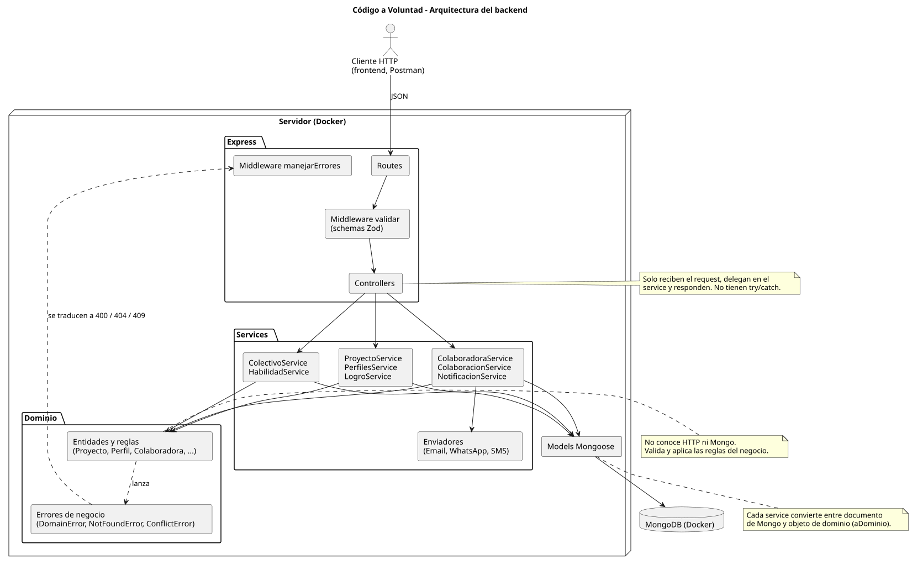
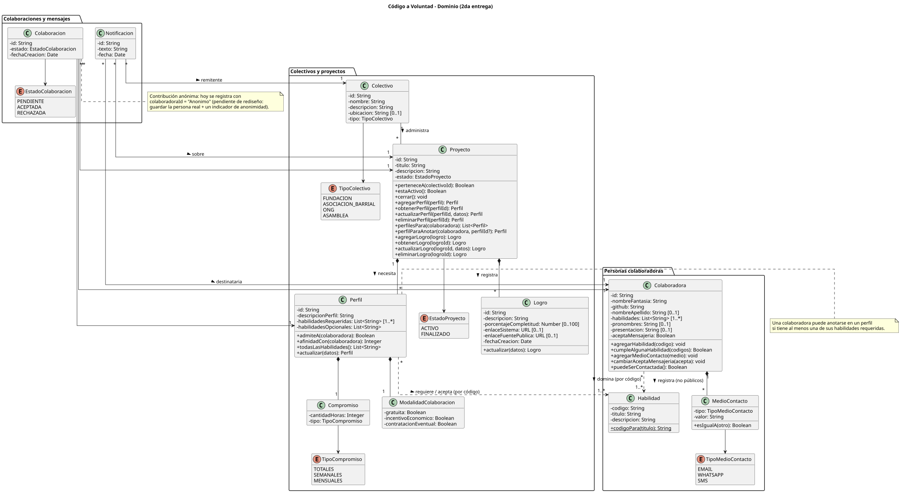
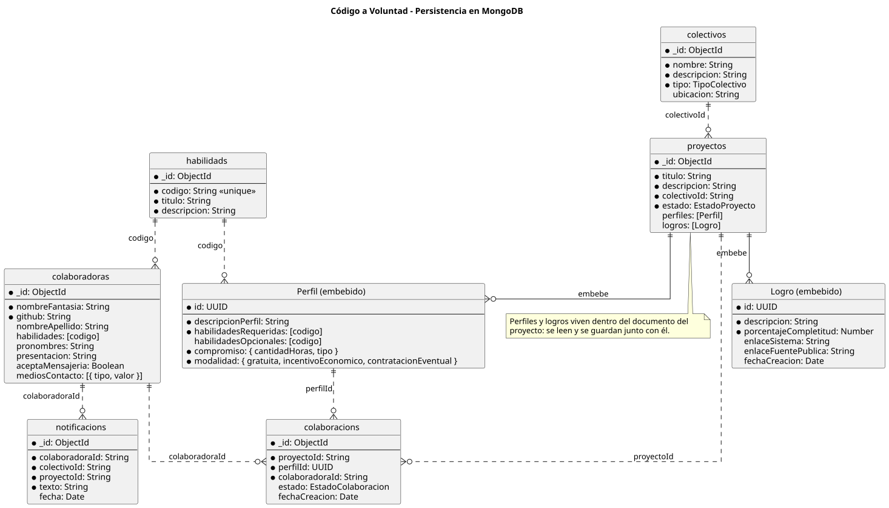

# Plataforma "Código a Voluntad"

Repositorio oficial del Trabajo Práctico Integrador de la materia **Desarrollo de Software** (2° Cuatrimestre 2026) de la **UTN FRBA** (Universidad Tecnológica Nacional, Facultad Regional Buenos Aires).

**Estado actual:** segunda entrega (API HTTP con persistencia en MongoDB).

---

## Integrantes del Equipo

* **Camila Sol Hernández Greco**
* **Santiago Martín**
* **Luca Belardinelli**
* **Francisco Nicolas Bosi**
* **Pedro Jose Nicolas Alvarez**

---

## Contenido

- [Descripción del proyecto](#descripción-del-proyecto)
- [Cómo levantarlo](#cómo-levantarlo)
- [Arquitectura](#arquitectura)
- [Dominio](#dominio)
- [Persistencia](#persistencia)
- [API](#api)
- [Datos semilla](#datos-semilla)
- [Tests](#tests)
- [Decisiones de diseño](#decisiones-de-diseño)
- [Pendientes](#pendientes)
- [Plan de entregas](#plan-de-entregas-e-iteraciones)
- [Git Flow](#git-flow)

---

## Descripción del Proyecto

**"Código a Voluntad"** es una plataforma de código libre diseñada para actuar como un puente solidario entre **colectivos** (fundaciones, asociaciones barriales, ONGs, asambleas y organizaciones territoriales) que necesitan soluciones de software de clase profesional pero carecen de recursos económicos, y **personas colaboradoras** del ámbito tecnológico dispuestas a aportar su talento, mano de obra y asesoramiento en desarrollo de software de forma altruista o colaborativa.

### Stack

| Capa | Tecnología |
|---|---|
| Backend | Node.js 20 + Express 5 |
| Validación de requests | Zod |
| Base de datos | MongoDB 7 con Mongoose |
| Testing | Jest + `mongodb-memory-server` (Mongo real en memoria) |
| Documentación de la API | Swagger / OpenAPI 3.0 + colección de Postman |
| Despliegue | Docker (una imagen para el backend y otra para MongoDB) |
| Frontend | React (tercera entrega) |

### Estructura del repositorio

```
├── docker-compose.yml            # backend + MongoDB
├── DEPLOY.md                     # guía de despliegue (local, Render, servidor propio)
└── packages/
    ├── backend/
    │   ├── index.js              # arranque de Express y montaje de rutas
    │   ├── docs/openapi.json     # especificación OpenAPI exportada
    │   ├── postman_collection.json
    │   ├── src/
    │   │   ├── routes/           # rutas HTTP + validación con Zod
    │   │   ├── controllers/      # reciben el request y delegan en los services
    │   │   ├── services/         # casos de uso: leen/guardan en Mongo y usan el dominio
    │   │   ├── domain/           # entidades y reglas de negocio (sin HTTP ni Mongo)
    │   │   ├── models/           # schemas de Mongoose
    │   │   ├── schemas/          # schemas de Zod de los bodies
    │   │   ├── middlewares/      # validar y manejarErrores
    │   │   ├── seeds/            # script semilla y sus datos
    │   │   └── docs/             # definición de Swagger
    │   └── test/                 # tests de dominio y de services
    ├── diagrama-de-clases/       # diagramas PlantUML (.puml) y su render (.svg)
    └── frontend/
```

---

## Cómo levantarlo

### Con Docker (todo junto)

Desde la raíz del repo:

```bash
docker compose up --build                      # backend en http://localhost:3000 + MongoDB
docker compose exec backend npm run seed       # carga los datos iniciales
curl http://localhost:3000/health
```

### En local, para desarrollar

Requiere Node.js 20 o superior.

```bash
npm install                                    # desde la raíz (npm workspaces)
docker compose up mongo                        # solo la base, en localhost:27017
cp packages/backend/.env.example packages/backend/.env
cd packages/backend
npm run seed                                   # datos iniciales
npm run dev                                    # backend con recarga automática
```

### Variables de entorno (`packages/backend/.env`)

| Variable | Para qué | Ejemplo |
|---|---|---|
| `MONGO_URI` | Conexión a MongoDB (obligatoria) | `mongodb://localhost:27017/codigo_a_voluntad` |
| `SERVER_PORT` / `PORT` | Puerto del backend (`PORT` tiene prioridad; por defecto 8000) | `8000` |
| `ALLOWED_ORIGINS` | Orígenes permitidos por CORS, separados por coma | `http://localhost:3000` |

### Scripts del backend (`packages/backend`)

| Comando | Qué hace |
|---|---|
| `npm run dev` | Levanta el backend con recarga automática |
| `npm start` | Levanta el backend |
| `npm run seed` | **Borra** las colecciones de `MONGO_URI` y carga los datos semilla |
| `npm test` | Corre los tests de dominio y de services |
| `npm run openapi` | Regenera `docs/openapi.json` a partir de la definición de Swagger |

El despliegue en producción está explicado en [DEPLOY.md](DEPLOY.md).

---

## Arquitectura

Cliente-servidor, con un backend organizado en capas. Cada capa solo conoce a la de abajo:



| Capa | Responsabilidad | No hace |
|---|---|---|
| **Routes** | Define las rutas y valida el body con Zod (`middlewares/validar.js`) | Lógica de negocio |
| **Controllers** | Toma los parámetros del request, llama al service y responde | `try/catch`, reglas, acceso a Mongo |
| **Services** | Casos de uso: buscan en Mongo, arman el objeto de dominio, le piden la operación y guardan | Reglas de negocio (las delega al dominio) |
| **Dominio** | Entidades con sus validaciones y reglas (por ejemplo, `Proyecto.perfilParaAnotar`) | Conocer HTTP o Mongo |
| **Models** | Schemas de Mongoose | Validaciones de negocio |

### Manejo de errores

El dominio y los services lanzan errores de negocio (`src/domain/errores.js`). El middleware `manejarErrores` los traduce a HTTP, así los controllers no necesitan `try/catch` (Express 5 propaga los errores de las funciones `async`):

| Error | Status | Cuándo |
|---|---|---|
| `DomainError` | 400 | Datos inválidos o se rompe una regla (ej.: la colaboradora no tiene ninguna habilidad requerida) |
| `NotFoundError` | 404 | El recurso no existe (o el id no tiene formato válido) |
| `ConflictError` | 409 | El pedido choca con el estado actual (ej.: ya está anotada, el proyecto ya está finalizado) |
| Otro | 500 | Error inesperado (se registra en la consola) |

Todas las respuestas de error tienen la forma `{ "error": "mensaje", "detalle": { ... } }`.

---

## Dominio



Fuente editable: [Diagrama.puml](packages/diagrama-de-clases/Diagrama.puml).

### Reglas de negocio implementadas

- **Proyectos y perfiles:** cada proyecto declara perfiles. Cada perfil tiene descripción, al menos una habilidad requerida, habilidades opcionales, un compromiso (horas totales, semanales o mensuales) y una modalidad (gratuita, con incentivo económico y/o con contratación eventual).
- **Anotarse en un proyecto:** la colaboradora necesita **al menos una** de las habilidades requeridas del perfil. Puede elegir el perfil; si no lo indica, queda en el primero que le corresponde. No se puede anotar dos veces en el mismo perfil.
- **Cierre:** solo el colectivo dueño puede cerrar un proyecto. Un proyecto finalizado no admite colaboraciones ni aparece en las búsquedas, y no se puede volver a cerrar.
- **Habilidades:** se identifican por su código, que es el título normalizado (`"Diseño UX"` → `"diseño-ux"`). Proyectos y colaboradoras solo pueden usar habilidades dadas de alta.
- **Medios de contacto:** email, WhatsApp o SMS, con validación de formato. Se registran internamente y **nunca** aparecen en las respuestas de la API.
- **Notificaciones:** un colectivo puede escribirle a una colaboradora sobre uno de sus proyectos solo si ella acepta la mensajería interna. Cada notificación se replica por todos sus medios de contacto.
- **Logros:** cada proyecto registra logros con su porcentaje de completitud (0 a 100) y enlaces opcionales al sistema y al código fuente público.
- **Búsquedas:** colaboradoras para un perfil (ordenadas por cuántas habilidades del perfil tienen) y proyectos activos para una colaboradora.

---

## Persistencia

Todas las entidades se guardan en MongoDB. Perfiles y logros se embeben en el documento del proyecto, porque siempre se leen y se modifican junto con él.



---

## API

La documentación completa (bodies, respuestas y errores de cada endpoint) está en **Swagger**, con el backend corriendo:

- Interfaz: `http://localhost:3000/api-docs`
- Especificación en JSON: `http://localhost:3000/api-docs.json` (también versionada en [`packages/backend/docs/openapi.json`](packages/backend/docs/openapi.json))

También hay una **colección de Postman** en [`packages/backend/postman_collection.json`](packages/backend/postman_collection.json). Está ordenada como un recorrido completo: se puede correr entera con el Runner (o `npx newman run`) después de cargar los datos semilla, y cada request verifica su status y guarda los ids que usan las siguientes.

### Endpoints

| Método | Ruta | Descripción |
|---|---|---|
| GET | `/health` | Health check |
| **Habilidades** | | |
| GET | `/api/habilidades` | Lista las habilidades |
| POST | `/api/habilidades` | Da de alta una habilidad |
| **Colectivos** | | |
| GET | `/api/colectivos` | Lista los colectivos |
| POST | `/api/colectivos` | Inscribe un colectivo |
| POST | `/api/colectivos/:colectivoId/proyectos` | Crea un proyecto del colectivo (con o sin perfiles) |
| PATCH | `/api/colectivos/:colectivoId/proyectos/:proyectoId` | Cierra el proyecto (`{ "estado": "FINALIZADO" }`) |
| **Proyectos** | | |
| GET | `/api/proyectos` | Lista los proyectos |
| GET | `/api/proyectos/:proyectoId` | Obtiene un proyecto con sus perfiles y logros |
| **Perfiles** | | |
| GET | `/api/proyectos/:proyectoId/perfiles` | Lista los perfiles del proyecto |
| POST | `/api/proyectos/:proyectoId/perfiles` | Agrega un perfil |
| GET | `/api/proyectos/:proyectoId/perfiles/:perfilId` | Obtiene un perfil |
| PUT | `/api/proyectos/:proyectoId/perfiles/:perfilId` | Actualiza los campos informados |
| DELETE | `/api/proyectos/:proyectoId/perfiles/:perfilId` | Elimina un perfil |
| **Búsquedas** | | |
| GET | `/api/proyectos/:proyectoId/perfiles/:perfilId/colaboradoras-potenciales` | Colaboradoras que encajan con un perfil |
| GET | `/api/colaboradoras/:id/proyectos-potenciales` | Proyectos que encajan con una colaboradora |
| **Colaboradoras** | | |
| GET | `/api/colaboradoras` | Lista las colaboradoras |
| POST | `/api/colaboradoras` | Registra una colaboradora |
| GET | `/api/colaboradoras/:id` | Obtiene una colaboradora |
| POST | `/api/colaboradoras/:id/habilidades` | Agrega una habilidad |
| POST | `/api/colaboradoras/:id/medios-contacto` | Registra un medio de contacto |
| PATCH | `/api/colaboradoras/:id/preferencias` | Indica si acepta mensajería interna |
| **Colaboraciones** | | |
| POST | `/api/proyectos/:proyectoId/colaboraciones` | Anota a una colaboradora en el proyecto |
| GET | `/api/proyectos/:proyectoId/colaboradoras` | Lista las colaboradoras anotadas |
| GET | `/api/colaboraciones` | Lista todas las colaboraciones |
| GET | `/api/colaboraciones/:colaboracionId` | Obtiene una colaboración |
| **Notificaciones** | | |
| POST | `/api/notificaciones` | Envía una notificación interna (y por medios externos) |
| GET | `/api/colaboradoras/:id/notificaciones` | Lista las notificaciones de una colaboradora |
| **Logros** | | |
| GET | `/api/proyectos/:proyectoId/logros` | Lista los logros del proyecto |
| POST | `/api/proyectos/:proyectoId/logros` | Registra un logro |
| GET | `/api/proyectos/:proyectoId/logros/:logroId` | Obtiene un logro |
| PUT | `/api/proyectos/:proyectoId/logros/:logroId` | Actualiza los campos informados |
| DELETE | `/api/proyectos/:proyectoId/logros/:logroId` | Elimina un logro |

### Ejemplo: anotar a una colaboradora

```http
POST /api/proyectos/650000000000000000000201/colaboraciones
Content-Type: application/json

{ "colaboradoraId": "650000000000000000000301" }
```

```json
{
  "id": "6aceb...",
  "proyectoId": "650000000000000000000201",
  "perfilId": "31cdd155-65d1-4085-82fb-affc97bdcd59",
  "colaboradoraId": "650000000000000000000301",
  "estado": "PENDIENTE",
  "fechaCreacion": "2026-10-13T23:18:07.767Z"
}
```

---

## Datos semilla

`npm run seed` borra las colecciones y carga 9 habilidades, 3 colectivos, 5 colaboradoras (con medios de contacto), 4 proyectos con perfiles (uno finalizado), 4 colaboraciones, una notificación y logros. Los datos pasan por las mismas validaciones del dominio que la API.

Los ids son fijos para poder usarlos directamente en las requests (el detalle está en [`src/seeds/datos.js`](packages/backend/src/seeds/datos.js)):

| Entidad | Id |
|---|---|
| Colectivo "Fundación Manos Unidas" | `650000000000000000000101` |
| Colectivo "Asamblea Villa Crespo" | `650000000000000000000102` |
| Colectivo "ONG Código Abierto" | `650000000000000000000103` |
| Proyecto "Web de donaciones" (perfiles Frontend y Tester, con logros) | `650000000000000000000201` |
| Proyecto "API de inventario" | `650000000000000000000202` |
| Proyecto "Plataforma de cursos" | `650000000000000000000203` |
| Proyecto "Encuesta vecinal" (finalizado) | `650000000000000000000204` |
| Colaboradora "Ada" (react, javascript; acepta mensajes) | `650000000000000000000301` |
| Colaboradora "Grace" (nodejs, bases-de-datos) | `650000000000000000000302` |
| Colaboradora "Lu" (diseño-ux; no acepta mensajes) | `650000000000000000000303` |
| Colaboradora "Pyto" (python, pandas) | `650000000000000000000304` |
| Colaboradora "Sol" (fullstack + testing) | `650000000000000000000305` |

Los ids de los perfiles se generan al cargar: se obtienen con `GET /api/proyectos/:proyectoId/perfiles`.

---

## Tests

```bash
cd packages/backend
npm test
```

- **Dominio** (`test/domain`): reglas de cada entidad, sin base de datos.
- **Services** (`test/services`): casos de uso contra un MongoDB real en memoria (`mongodb-memory-server`). Cada archivo usa su propia base y la limpia entre tests.

Para probar la API de punta a punta: levantar el stack con Docker, cargar el seed y correr la colección de Postman (`npx newman run packages/backend/postman_collection.json`).

---

## Decisiones de diseño

- **Las habilidades se referencian por código**, no por título ni por id de Mongo. El código es único y legible, y es lo que el enunciado define como identificador.
- **Alcanza con una habilidad requerida para anotarse**, como pide el enunciado ("al menos una de las habilidades requeridas"). Las opcionales solo cuentan para ordenar las búsquedas.
- **La colaboración queda asociada a un perfil.** El enunciado de la 2da entrega habla de anotarse al proyecto; guardar el perfil no cambia eso (se asigna solo si no se elige) y prepara la 3ra entrega, donde las postulaciones son por perfil.
- **Una colaboración por persona y perfil**: anotarse dos veces en el mismo perfil devuelve 409. El enunciado no lo exige; lo elegimos porque una colaboración representa una participación, no un evento.
- **Fecha de la colaboración:** el enunciado no la pide, pero se guarda para poder armar el historial de cada colaboradora.
- **Perfiles y logros embebidos en el proyecto:** pertenecen a un único proyecto y siempre se consultan junto con él.
- **Ids de perfiles y logros como UUID:** se generan en el backend para poder referenciarlos en la API sin depender del `_id` interno de Mongo.
- **El dominio valida antes de guardar:** ningún dato inválido llega a la base, aunque pase la validación de Zod.

---

## Pendientes

- **Contribuciones anónimas:** hoy una colaboración anónima se guarda con `colaboradoraId = "Anonimo"`, lo que pierde quién la hizo. La idea es guardar siempre la persona real con un indicador `anonima` y ocultar la identidad solo en las vistas públicas.
- **Nombres de las colecciones:** Mongoose pluraliza en inglés (`habilidads`, `colaboracions`, `notificacions`).

---

## Plan de Entregas e Iteraciones

### Primera Entrega
* **Alcance:** Despliegue inicial y API HTTP inicial.
* **Requerimientos mínimos:**
  * Implementación de los elementos del dominio bajo arquitectura de capas.
  * Endpoints REST para carga de colectivos, colaboradores, habilidades y proyectos.
  * Anotación de colaboradores a proyectos con validación de habilidades.
  * Cierre manual de proyectos.
  * Endpoint de *Health Check*.
* **Entregables:** Diagrama de clases, implementación completa de endpoints, explicación de Git Flow y despliegue inicial.

### Segunda Entrega
* **Alcance:** Segunda iteración de la API HTTP, persistencia y despliegue.
* **Cambios al dominio:**
  * Transición a perfiles requeridos (habilidades obligatorias y opcionales, compromisos y modalidades por perfil).
  * Contribuciones anónimas y gestión interna de medios de contacto.
  * Búsquedas cruzadas y notificaciones internas y por medios alternativos.
  * Carga de logros, porcentajes de avance y enlaces públicos.
* **Tecnologías:** MongoDB, Jest, Swagger automático.

### Tercera Entrega
* **Alcance:** Interfaz de usuario (UI), sistema de autenticación (Login), postulaciones y despliegue final.
* **Cambios al dominio:**
  * Límites de colaboraciones por perfil y estados de búsqueda abierta/cerrada.
  * Sistema de postulaciones (revisión, aceptación y rechazo manual por parte del colectivo).
  * Funcionalidad de desanotación mutua con advertencias en interfaz.
* **Requerimientos de UI & UX:**
  * Interfaz intuitiva y consistente inspirada en patrones de e-commerce.
  * Feedback visual (loaders, skeletons, alertas de error/confirmación).
  * Diseño completamente responsivo y buenas prácticas de accesibilidad (contrastes, navegación por teclado, etiquetas ARIA).
  * Pantallas completas para gestión de organizaciones, colaboradores, proyectos, búsquedas, mensajería interna, postulaciones y perfiles.

---

## Git Flow

Para el desarrollo colaborativo de este proyecto, el equipo adopta el siguiente flujo de trabajo basado en **Git Flow**:

1. **`main` / `master`**: Rama principal que contiene el código estable correspondiente a cada entrega oficial aprobada.
2. **`develop`**: Rama de integración para las nuevas funcionalidades. Todas las ramas de características (`feature/*`) parten y se integran aquí mediante Pull Requests.
3. **`feature/*`**: Ramas individuales creadas para el desarrollo de cada historia de usuario o componente específico (ej. `feature/gestion-colectivos`, `feature/api-postulaciones`, `feature/ui-login`).
4. **`release/*`**: Ramas utilizadas para preparar las versiones de entrega final, pruebas de integración y corrección menor de errores.
5. **`hotfix/*`**: Ramas dedicadas a solucionar errores críticos detectados en producción de manera urgente.
